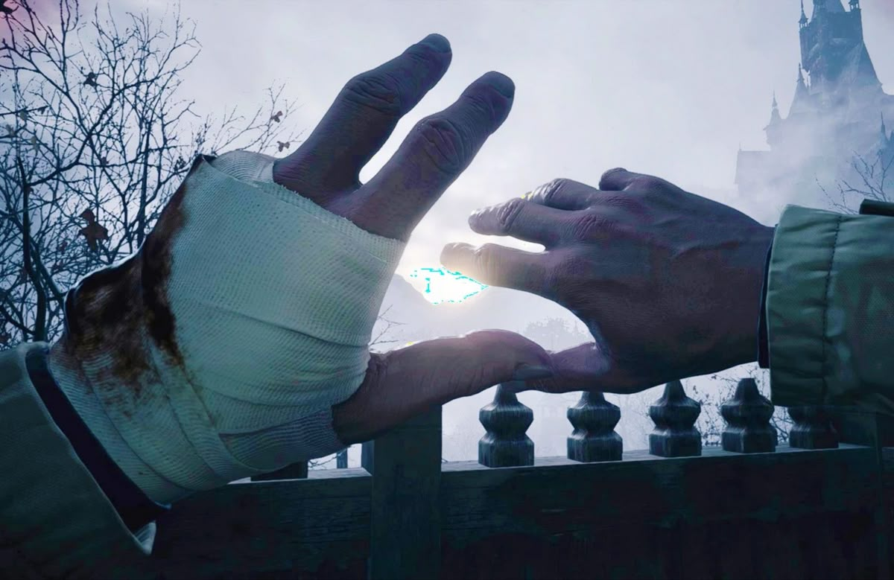

 $${\color{#ffffff} placeholder ⠀text ⠀with⠀unicode}$$  

 

  placeholder

> wip readme

  
  

 <a href="https://mortisfication.atabook.org"> sign ata if you want https://mortisfication.atabook.org </a> 

  

  

                                                                                      
